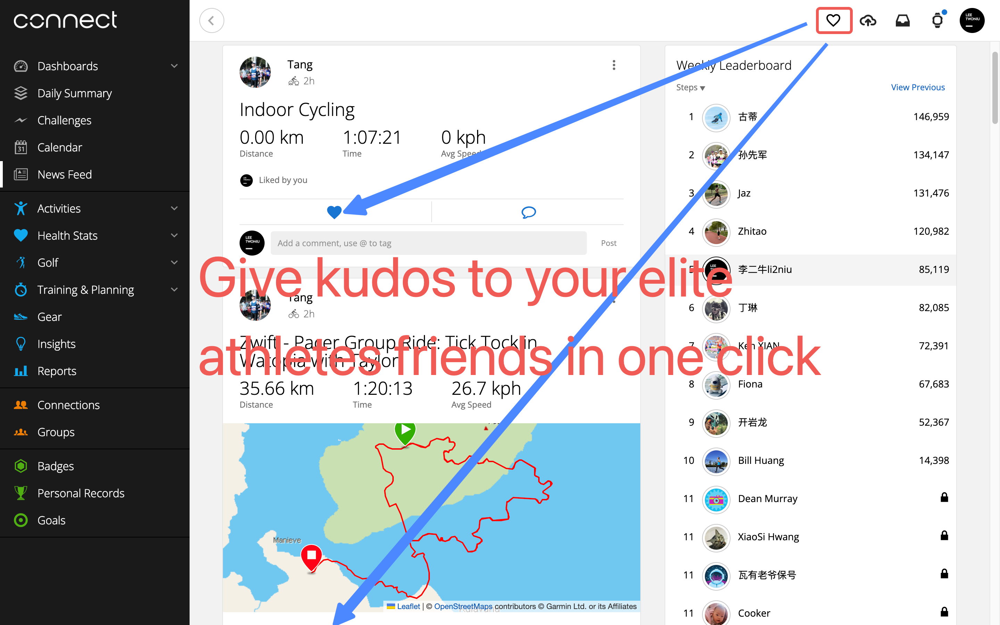

# GCW&Strava Kudo All

这是一个 Chrome/Firefox/Safari 插件，用于在 [GCW（Garmin Connect Web）](https://connect.garmin.cn/app/newsfeed) 和 [Strava](https://www.strava.com/dashboard) 中一键给你的精英运动员朋友们点赞。

[English](./README.md)

## 截图

## 下载安装

- [Firefox](https://addons.mozilla.org/en-US/firefox/addon/kudo-all/)
- [Google Chrome](https://chrome.google.com/webstore/detail/gcw-and-strava-kudo-all/folhiecfhnmdniibjjcfogpdoafdamoc)
- [Mac Safari 版 · 一次性购买](https://apps.apple.com/app/apple-store/id6458730808?pt=125713495&ct=kudo_safari_readme&mt=8) · [功能与启用步骤](https://kudoall.li2niu.com/safari/zh/)
- [Microsoft Edge](https://microsoftedge.microsoft.com/addons/detail/gcw-and-strava-kudo-all/lmopbhpibkfcmbgipoalokaemgnlmjdn)
- 或者从 crx 安装 [.crx](./crx-files.md)

  

  

### Mac Safari 使用入门

Safari 版需要 **macOS 12 或更新版本的 Mac**，在 Mac App Store 一次性购买，无订阅，价格以你所在地区商店显示为准。本版本用于 Mac Safari，不适用于 iPhone 或 iPad。

1. [从 Mac App Store 下载 Kudo All](https://apps.apple.com/app/apple-store/id6458730808?pt=125713495&ct=kudo_safari_readme&mt=8)，安装后先打开 Mac 应用一次。
2. 在 Safari 菜单中打开 **Safari 浏览器 → 设置 → 扩展**（旧版为 **偏好设置 → 扩展**），勾选 **Kudo All：佳明与 Strava 一键点赞**（英文界面显示 **Kudo All: Strava & Garmin**）。允许你使用的 Garmin Connect 或 Strava 站点；Safari 弹出网站授权时，选择仅始终允许当前网站的选项，英文为 **Always Allow on This Website**，无需授权全部网站。
3. 登录并打开 [Garmin 国际区动态](https://connect.garmin.com/app/newsfeed)、[Garmin 中国区动态](https://connect.garmin.cn/app/newsfeed)、[Garmin 中国区 connectus 动态](https://connectus.garmin.cn/app/newsfeed)或 [Strava Dashboard](https://www.strava.com/dashboard)，然后刷新网页。点击页内的“一键点赞”，或打开 Safari 工具栏中的扩展面板查看可点赞数量并执行。页面未连接时可点“重新连接”；重新连接本身不会开始点赞。

网站授权、结果说明、常见问题与卸载步骤见 [Safari 完整用户指南](./docs/safari-setup-zh.md)（[官网在线版](https://kudoall.li2niu.com/help/safari/zh/)）。[Safari 版功能与演示](https://kudoall.li2niu.com/safari/zh/)。

## 广告

- [Immersive Translate 沉浸式翻译](https://immersivetranslate.com/?via=li2niu)

## FAQ

### 点击按钮在哪里?

GCW 中，在右上角导航栏的“上传活动”旁边，显示为心形的“一键点赞”图标。

Strava dashboard 中，在右上角导航栏；常规动态导航不可用时会显示浮动按钮。

在支持的 Garmin Connect 或 Strava 动态页，浏览器扩展图标都可打开状态面板，查看页面连接、可点赞数量和上次执行结果，也可重新连接页面或使用备用点赞入口。

### 有效的域名及链接

- https://connect.garmin.com/app/newsfeed
- https://connect.garmin.cn/app/newsfeed
- https://connectus.garmin.cn/app/newsfeed
- https://www.strava.com/dashboard

Garmin 旧版 `/modern/newsfeed` 路径也受支持；Strava 也支持 https://strava.com/dashboard。个人主页和单条活动详情页都不是支持的动态页。

### 点赞的范围是?

Garmin Connect 和 Strava 都会处理动态中已加载、符合条件的活动，跳过已经点赞的活动。想处理更多活动时，先滚动加载，再点击一次；插件不会自动滚动。结果计数反映页面显示的状态。

### 点赞的意义是?

- 培育你的友谊小树苗，茁壮成长。
- 鼓励你的运动员朋友，再接再厉。

### 能否支持自动点赞?

每次执行都由你的点击开始，只处理动态中已加载、符合条件的活动；不会自动滚动、加载更多活动，也不会在后台无限自动点赞。

## 鸣谢

- [Strava 的 Kudo All](https://github.com/tciles/kudo-all)
- Four Times 俱乐部，因为群友我才了解到原项目的存在，并在休息日产生兴趣移植到 Garmin 平台。给四次的群友点赞，他们的努力的耕耘模样令人感动 🐶，比如蔡哥。

## 我的更多插件

- [GameraSnap-使用佳明手表控制手机拍照](https://gamerasnap.li2niu.com/)
- [更多插件](https://extensions.li2niu.com)
- [NewQRCode-在智能手表上展示二维码](https://q.li2niu.com)

## 插件友情推荐

[Strava Assistant](https://www.stravassistant.icu)

## 隐私协议

[隐私协议](./privacy-policy-zh.md)

## 开发者文档

在 EGO 本地测试时，先关闭商店安装版，再将本仓库的 `src` 目录加载为已解压的扩展，确认显示版本与 [src/manifest.json](./src/manifest.json) 的 `version` 字段一致。修改源码后，先重新加载扩展，再刷新动态页。具体操作见 [EGO 调试与发布检查](./docs/ego-debugging.md)，版本以 manifest 为准。

EGO 加载已解压扩展、Safari MCP 和 **Allow Unsigned Extensions（允许未签名的扩展）**属于开发者调试工具。Mac App Store 用户的安装步骤见上方 Safari 用户指南。
